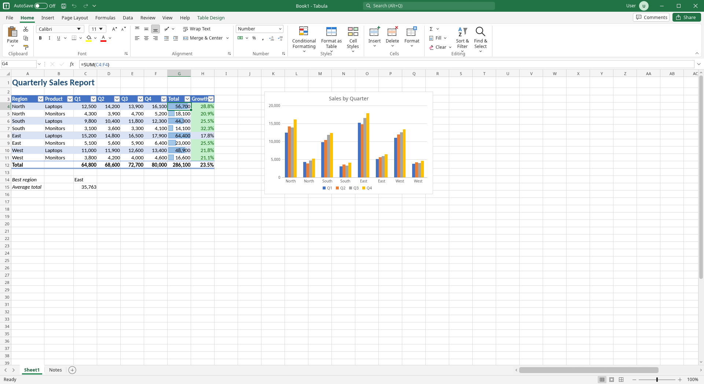
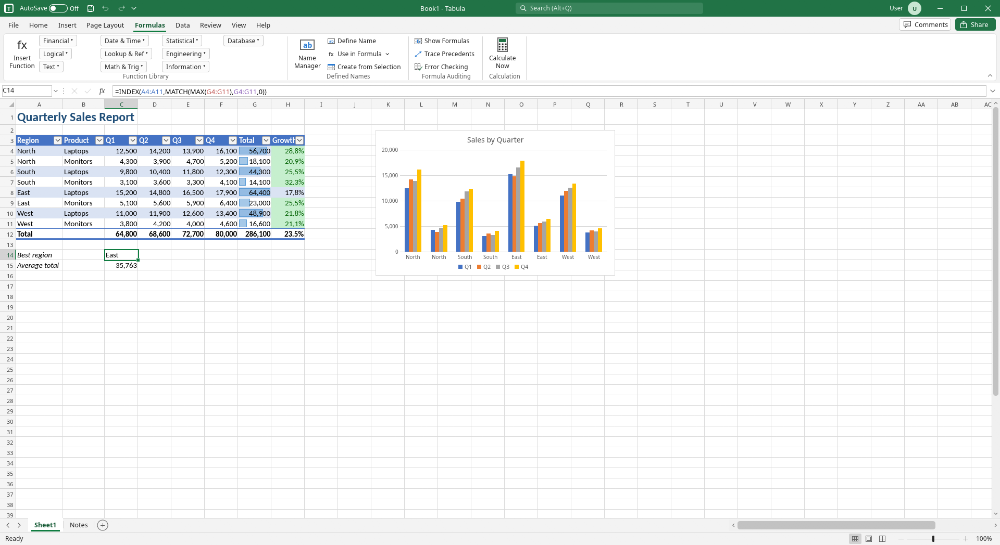
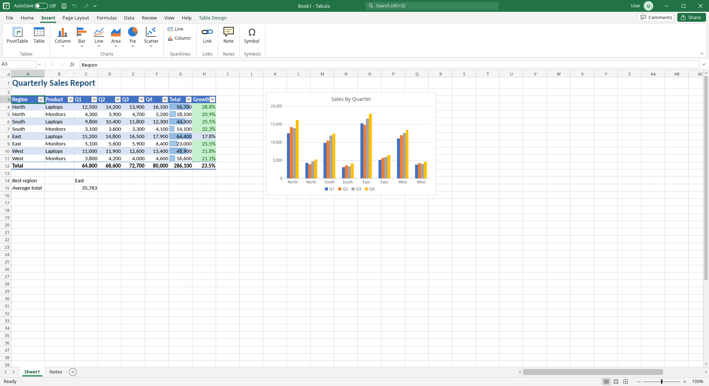
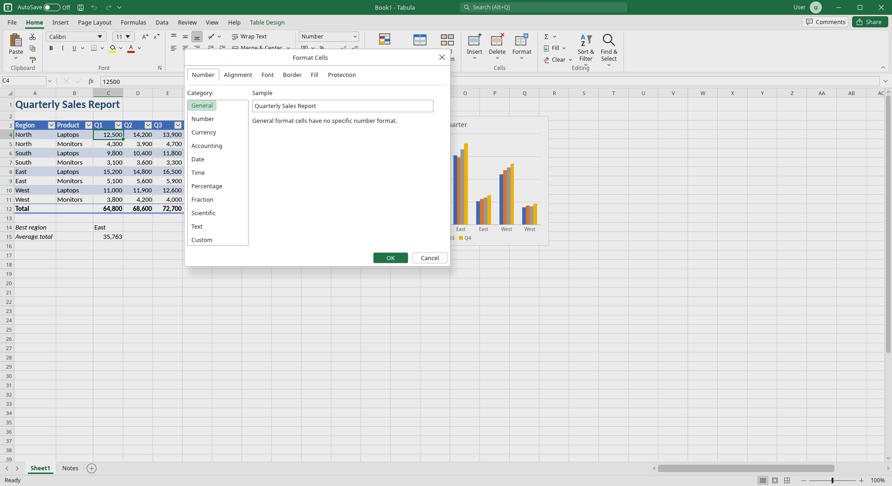
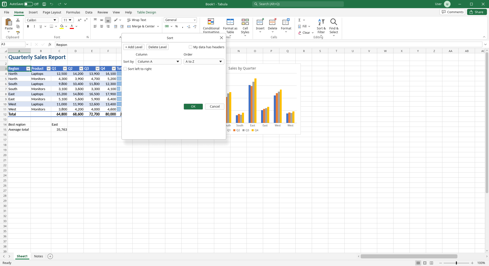
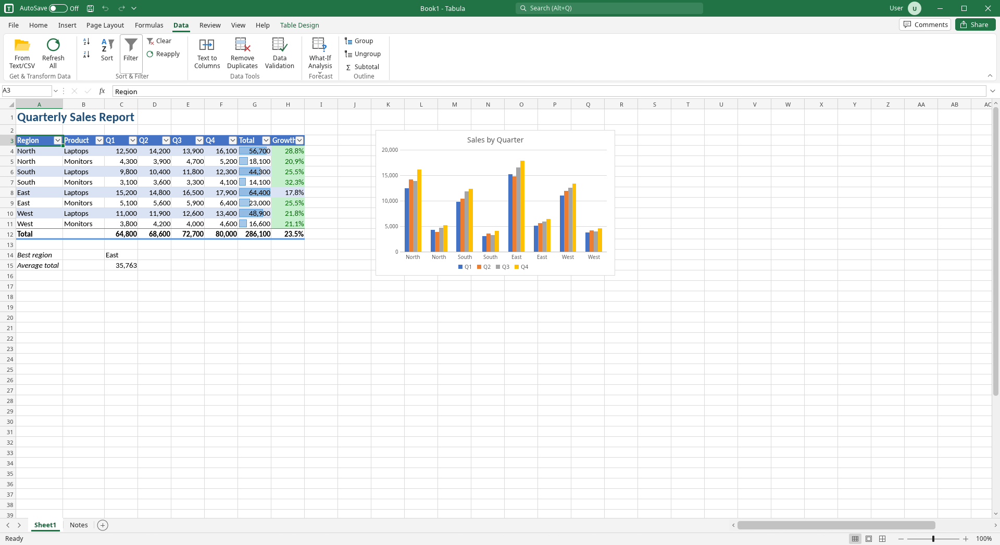
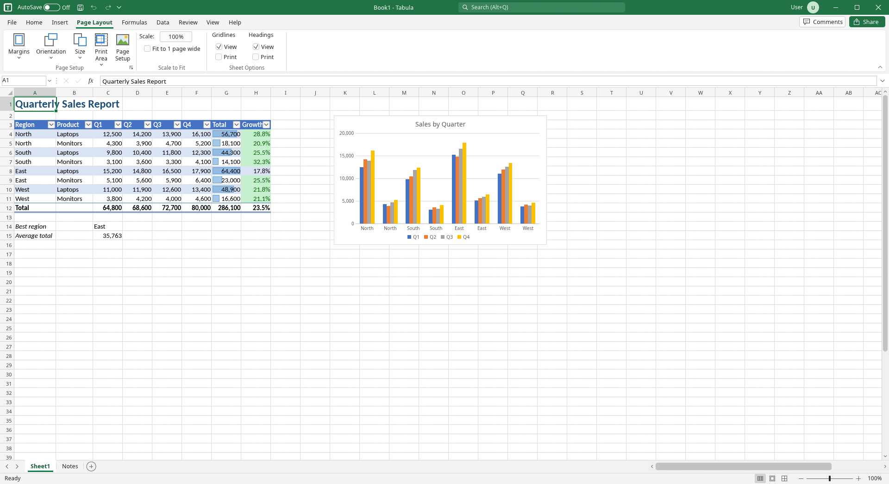
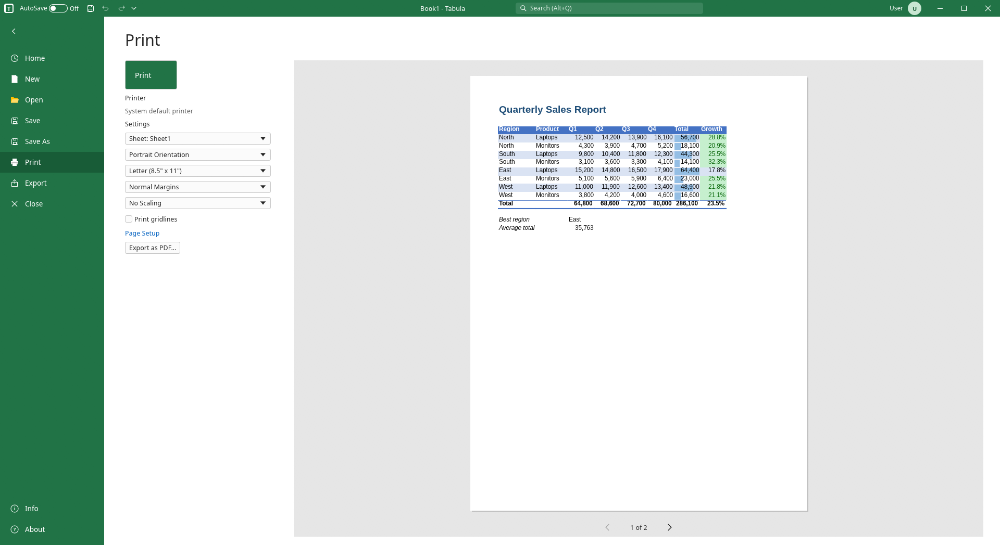
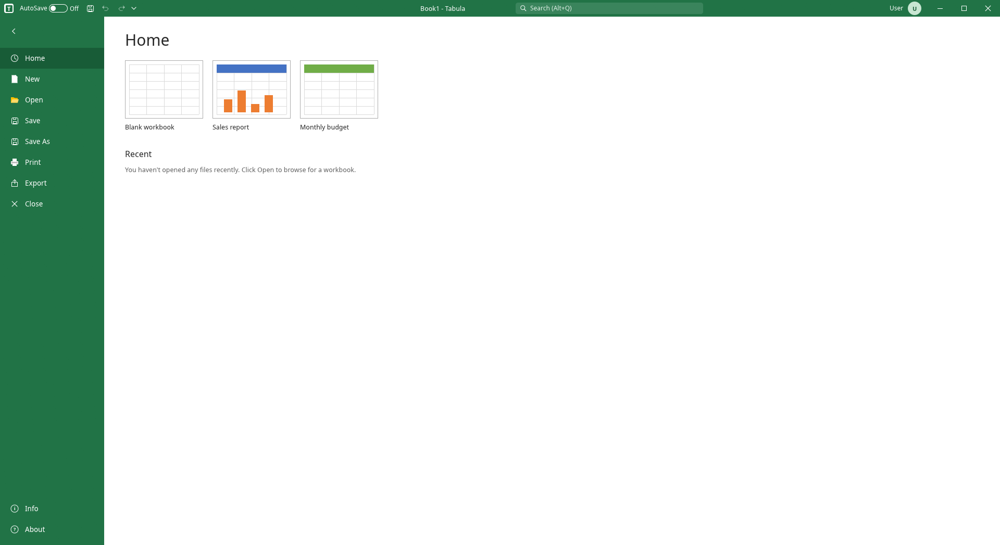

<div align="center">

# LibreExcel

### Tabula: a libre spreadsheet with the Excel interface you already know

Free and open-source desktop spreadsheet app that looks, feels and works like Microsoft Excel.<br>
Native, fast and written in Rust. No account, no subscription, no telemetry.

[](https://github.com/AhmAbd/LibreExcel/actions/workflows/ci.yml)
[](https://github.com/AhmAbd/LibreExcel/releases)
[](LICENSE)
[](https://www.rust-lang.org)
[](#install)

[Features](#features) · [Screenshots](#screenshots) · [Install](#install) · [Build](#build-from-source) · [Roadmap](#roadmap) · [Contributing](CONTRIBUTING.md)



</div>

## Why LibreExcel?

Millions of people learned spreadsheets on Excel. Free alternatives exist, but
they ask you to relearn where everything is. **Tabula keeps the Excel layout and
behavior**: the ribbon, the formula bar, the Name Box, the sheet tabs, the
Backstage File view, the dialogs and the keyboard shortcuts. If you know Excel,
you already know Tabula.

- **Libre:** MIT-licensed. Use it, study it, change it, share it.
- **Familiar:** Excel-style UI and Excel-compatible formulas.
- **Compatible:** opens and saves real `.xlsx` workbooks, plus `.ods` and CSV.
- **Native and light:** a single Rust binary built on [egui](https://github.com/emilk/egui). Starts in a blink.

## Features

### Excel-style interface
- Ribbon with **Home, Insert, Page Layout, Formulas, Data, Review, View and Help** tabs, plus contextual **Table Design** and **Chart Design** tabs
- Quick Access Toolbar, AutoSave toggle, search box and title bar
- Formula bar with Name Box, syntax-colored cell references and an expandable edit area
- Sheet tabs (add, rename, reorder), status bar with view modes and zoom
- Backstage **File** view: Home, New (templates), Open, Save, Save As, Print, Export, Info and About

### Formula engine
- **400+ Excel functions** across math, statistical, text, logical, lookup and reference, date and time, financial, engineering, database and information categories
- Modern Excel functions: `XLOOKUP`, `FILTER`, `SORT`, `UNIQUE`, `SEQUENCE`, `LET`, `LAMBDA`, `MAP`, `BYROW`, `BYCOL`, `HSTACK`, `VSTACK`, `CHOOSECOLS` and more
- Dynamic arrays, absolute and relative references, cross-sheet references and defined names
- Formula autocomplete, trace precedents, error checking and Show Formulas

### Formatting
- Fonts, fills, borders, alignment, wrap text, merge and center
- Excel number formats: General, Number, Currency, Accounting, Date, Time, Percentage, Fraction, Scientific, Text and Custom
- Full **Format Cells** dialog with Number, Alignment, Font, Border, Fill and Protection tabs
- Cell styles and **Format as Table** with banded rows and header filters
- **Conditional formatting**: highlight rules, text rules, duplicates, top/bottom, above/below average, formulas, color scales, data bars and icon sets

### Data tools
- Multi-level **Sort**, **AutoFilter**, Remove Duplicates, Subtotals and Data Validation
- **PivotTables**
- Find and Replace, Go To and Fill
- Freeze Panes and cell Notes

### Charts
- Column, stacked column, bar, stacked bar, line, line with markers, area, pie, doughnut and scatter
- Sparklines (line and column)

### Files, printing and export
- Open and save **Excel workbooks (`.xlsx`)**
- Open and save **OpenDocument spreadsheets (`.ods`)** for LibreOffice users
- Import and export **CSV** and **tab-separated** text
- **Print preview**, Page Setup (orientation, paper size, margins, scaling, gridlines) and **Export as PDF**
- Undo and redo, recent files and optional AutoSave

## Screenshots

| | |
|:---:|:---:|
|  |  |
| **Formulas** tab with an `INDEX`/`MATCH` formula | **Insert** tab: tables, charts, sparklines |
|  |  |
| **Format Cells** dialog | Multi-level **Sort** |
|  |  |
| **Data** tab | **Page Layout** tab |
|  |  |
| **Print** preview and PDF export | Backstage **Home** with templates |

## Install

### Download a release

Prebuilt binaries for Linux, Windows and macOS are on the
[Releases page](https://github.com/AhmAbd/LibreExcel/releases).

- **Linux:** download `tabula-linux-x86_64.tar.gz`, extract it and run `./tabula`.
- **Windows:** download `tabula-windows-x86_64.zip`, extract it and run `tabula.exe`.
- **macOS:** download `tabula-macos-aarch64.tar.gz`, extract it and run `./tabula`. The binary is not signed, so the first time you may need to right-click it and choose **Open**.

### Build from source

You need the stable [Rust toolchain](https://rustup.rs).

```bash
git clone https://github.com/AhmAbd/LibreExcel.git
cd LibreExcel
cargo build --release
```

The binary is at `target/release/tabula` (`tabula.exe` on Windows).

On Debian or Ubuntu, install the system libraries first:

```bash
sudo apt install libxkbcommon-dev libxcb-render0-dev libxcb-shape0-dev libxcb-xfixes0-dev libgl1-mesa-dev
```

On Linux, Tabula runs on both Wayland and X11.

## Usage

Start Tabula with an empty workbook:

```bash
tabula
```

Or open a file directly:

```bash
tabula path/to/workbook.xlsx
```

Most Excel keyboard shortcuts work as you expect: `Ctrl+C`/`Ctrl+V`, `Ctrl+Z`/`Ctrl+Y`,
`Ctrl+B`/`Ctrl+I`/`Ctrl+U`, `Ctrl+F`, `Ctrl+S`, `F2` to edit a cell, `Ctrl+Arrow` to jump
to the data edge and <kbd>Ctrl</kbd>+<kbd>`</kbd> to show formulas.

## Development

```bash
cargo run              # debug build
cargo test             # formula engine tests
cargo build --release  # optimized build
```

### Project layout

| Path | What it holds |
|---|---|
| `src/main.rs` | App entry point and window layout |
| `src/app.rs` | App state, selection, undo/redo, commands |
| `src/model.rs` | Workbook, sheet, cell and style data model |
| `src/formula.rs`, `src/eval.rs` | Formula parser and evaluator |
| `src/funcs*.rs` | Built-in function library (math, stat, text, lookup, financial) |
| `src/numfmt.rs` | Excel number format engine |
| `src/cond.rs` | Conditional formatting |
| `src/ops.rs` | Editing operations: insert, delete, sort, fill, pivot |
| `src/ribbon.rs`, `src/chrome.rs`, `src/menus.rs` | Ribbon, title bar, status bar, menus |
| `src/grid.rs`, `src/grid_input.rs` | Grid rendering and input |
| `src/dialogs.rs`, `src/dialog_tabs.rs`, `src/dialog_ui.rs` | Dialogs (Format Cells, Sort and others) |
| `src/backstage.rs` | File (Backstage) view |
| `src/charts.rs` | Charts and sparklines |
| `src/print.rs` | Print preview and PDF export |
| `src/xlsx_read.rs`, `src/xlsx_write.rs`, `src/ods.rs` | File formats |
| `assets/fonts/` | Bundled metric-compatible fonts |

### Screenshots for docs

Tabula can render itself to a PNG, which is how the images in this README are made:

```bash
TABULA_SHOT_TAB=formulas TABULA_SHOT_CELL=C14 \
  target/release/tabula --screenshot docs/screenshots/formulas.png
```

`TABULA_SHOT_VIEW` opens a page or dialog first (`format`, `sort`, `pagesetup`,
`print`, `home`, `about`). `TABULA_SHOT_FRAME` sets how many frames to wait
before capture.

## Roadmap

- [ ] Signed installers and Linux packages (Flatpak, AppImage, `.deb`)
- [ ] More chart types and chart formatting options
- [ ] Threaded comments
- [ ] Split view
- [ ] Localization
- [ ] Dark theme

Ideas and requests are welcome in [Issues](https://github.com/AhmAbd/LibreExcel/issues).

## Contributing

Contributions of all sizes are welcome: bug reports, Excel compatibility gaps,
new functions, UI polish and docs. Read [CONTRIBUTING.md](CONTRIBUTING.md) to
get started, and follow our [Code of Conduct](CODE_OF_CONDUCT.md).

## License

LibreExcel (Tabula) is released under the [MIT License](LICENSE).

The fonts in `assets/fonts/` (Liberation, Carlito and Noto) are third-party
fonts under the SIL Open Font License 1.1. They are not covered by the MIT
License. See [assets/fonts/README.md](assets/fonts/README.md).

## Disclaimer

LibreExcel is an independent project. It is not affiliated with, endorsed by or
sponsored by Microsoft. Microsoft and Excel are trademarks of the Microsoft
group of companies.
